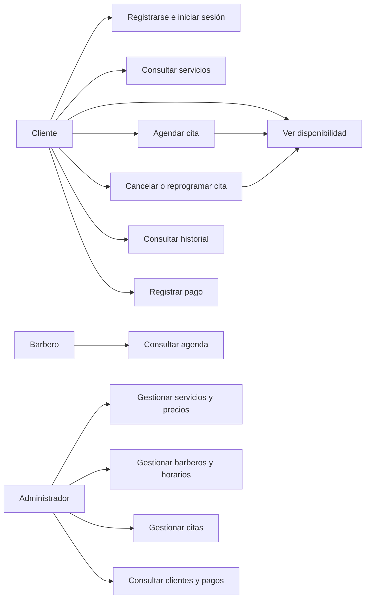
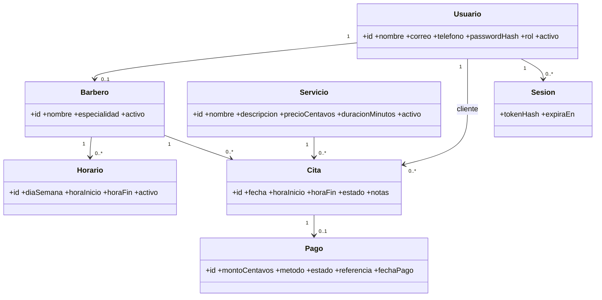
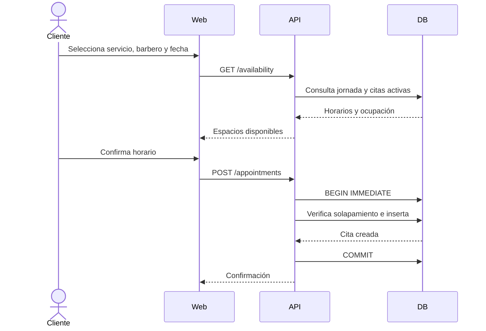
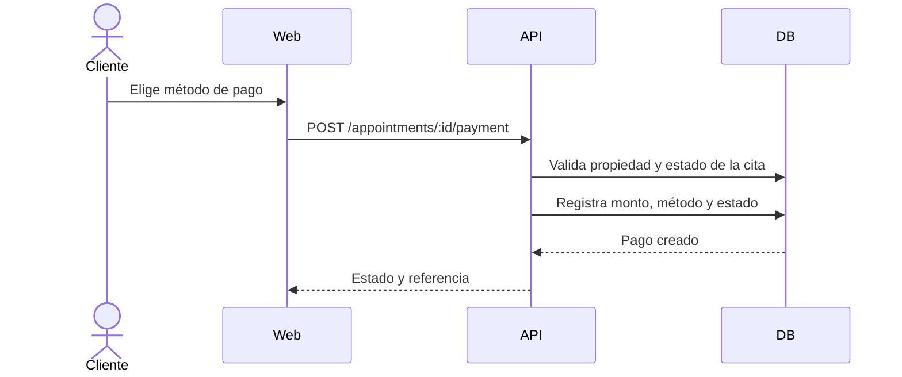
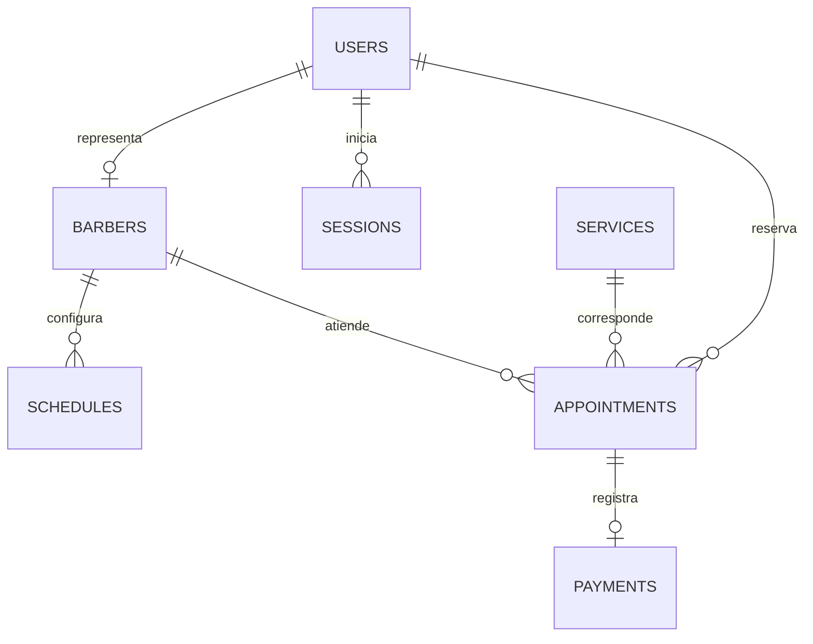

# Documento de diseño

## Arquitectura propuesta

Monolito modular en capas: interfaz web, API HTTP, servicios de dominio y persistencia SQLite. La arquitectura reduce la complejidad operativa y permite mantener módulos separados sin introducir microservicios innecesarios para el alcance del SRS.

## Casos de uso

## Clases UML

## Secuencia 1: reservar una cita

## Secuencia 2: registrar un pago

## Modelo entidad relación

## Modelo relacional

| Tabla | Atributos principales |
| --- | --- |
| users | id PK, name, email UQ, phone, password_hash, role, active, created_at |
| barbers | id PK, user_id FK/UQ, name, specialty, active |
| services | id PK, name, description, price_cents, duration_minutes, active |
| schedules | id PK, barber_id FK, weekday, start_time, end_time, active, UQ(barber_id, weekday) |
| appointments | id PK, client_id FK, barber_id FK, service_id FK, appointment_date, start_time, end_time, status, notes, timestamps |
| payments | id PK, appointment_id FK/UQ, amount_cents, method, status, reference, paid_at, created_at |
| sessions | token_hash PK, user_id FK, expires_at |

## Prototipos de interfaz

La implementación contiene los prototipos funcionales de inicio y catálogo, reserva con disponibilidad y panel administrativo. Las capturas se incluyen en el documento formal del Entregable 2.
